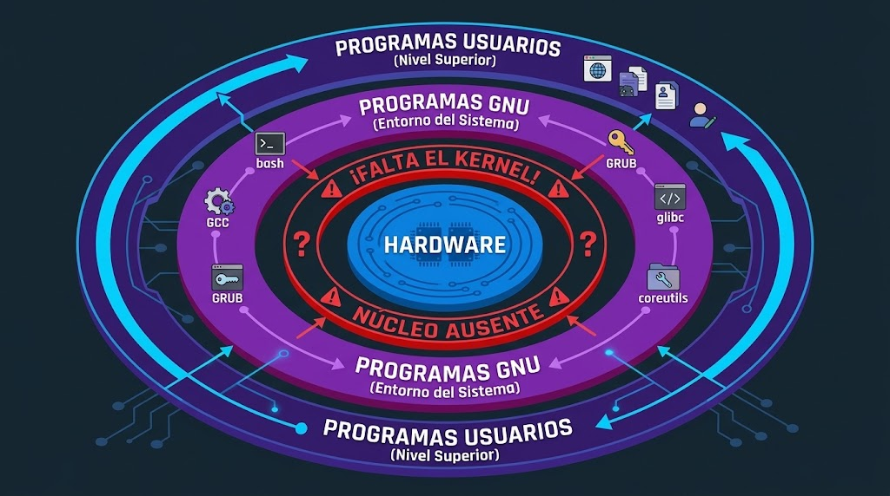
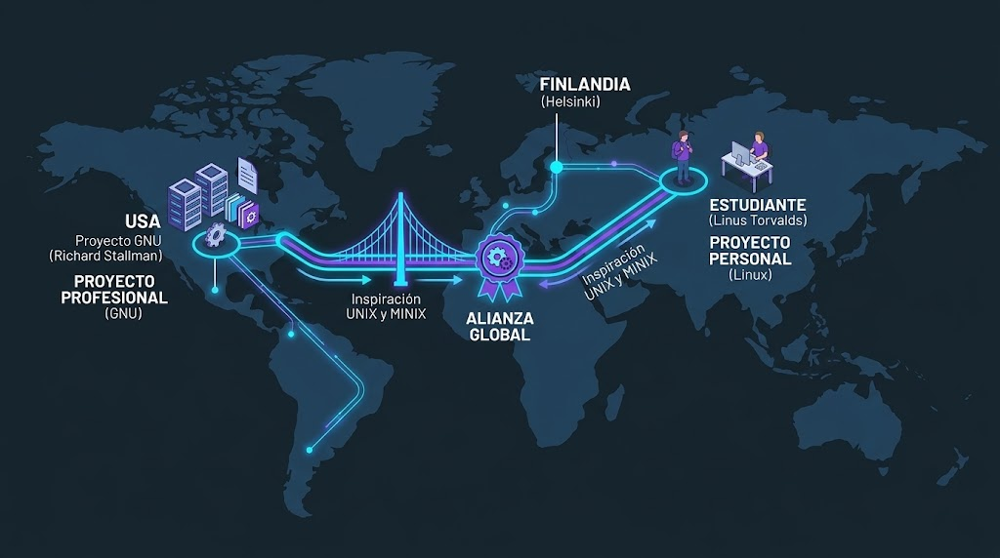

<!-- Slide 1: Título y Portada -->

  

  

    
Día 1 // Orígenes y Comandos

    <h1>El Arte de la Programación en Unix</h1>
    
Profesor Alison Muñoz Capote

  

  

    
  

---

<!-- Slide 2: Temario (Hoja de Ruta de Winston) -->

Hoja de Ruta

<h2>Mapa de la Sesión</h2>

  <ul style="list-style: none; padding: 0; line-height: 2.2; font-size: 1.2em; color: var(--dark);">
    <li><i class="fa-solid fa-terminal" style="color: var(--electric); width: 40px;"></i> <b>1. La Promesa:</b> Tomar el control del sistema.</li>
    <li><i class="fa-solid fa-code-branch" style="color: var(--violet); width: 40px;"></i> <b>2. Génesis:</b> La filosofía de Unix.</li>
    <li><i class="fa-solid fa-microchip" style="color: var(--electric); width: 40px;"></i> <b>3. Arquitectura:</b> Usuario, Shell y Kernel.</li>
    <li><i class="fa-solid fa-folder-tree" style="color: var(--violet); width: 40px;"></i> <b>4. Navegación:</b> Comandos de exploración.</li>
    <li><i class="fa-solid fa-gamepad" style="color: var(--electric); width: 40px;"></i> <b>5. El Reto:</b> Escape Room Forense.</li>
  </ul>

---

<!-- Slide 3: La Promesa de Winston -->

  

    <i class="fa-solid fa-unlock-keyhole" style="font-size: 3em; color: var(--electric); margin-bottom: 20px;"></i>
    <h2 style="color: var(--dark); font-size: 1.8em; line-height: 1.4; margin: 0;">
      Hoy perderán el miedo a la Terminal y transmutarán de usuarios pasivos a operadores absolutos del sistema.
    </h2>
  

---

<!-- Slide 3.0: Línea de Tiempo Histórica -->

  
Cronología

  <h2 style="margin-bottom: 60px;">La Evolución del Control</h2>

  <!-- Contenedor de la línea de tiempo -->
  
    
    <!-- Línea conectora con gradiente Cyber-Academy -->
    

    <!-- Nodo 1: 1950s -->
    

      

        <i class="fa-solid fa-server" style="color: var(--electric); font-size: 1.5em;"></i>
      

      <h3 style="margin-bottom: 5px; font-size: 1.1em;">1950s</h3>
      
Hardware Tirano

      
Dependencia absoluta.

    

    <!-- Nodo 2: 1969 -->
    

      

        <i class="fa-solid fa-layer-group" style="color: var(--violet); font-size: 1.5em;"></i>
      

      <h3 style="margin-bottom: 5px; font-size: 1.1em;">1969</h3>
      
Nace Unix

      
Estandarización modular.

    

    <!-- Nodo 3: 1983 -->
    

      

        <i class="fa-solid fa-circle-nodes" style="color: var(--electric); font-size: 1.5em;"></i>
      

      <h3 style="margin-bottom: 5px; font-size: 1.1em;">1983</h3>
      
Proyecto GNU

      
Ecosistema libre sin núcleo.

    

    <!-- Nodo 4: 1991 -->
    

      

        <i class="fa-brands fa-linux" style="color: var(--violet); font-size: 1.5em;"></i>
      

      <h3 style="margin-bottom: 5px; font-size: 1.1em;">1991</h3>
      
Nace Linux

      
El motor pragmático.

    

  

---

<!-- Slide 3.1: El Problema Original -->

  
La Era Pre-Unix (1950s - 1960s)

  <h2 style="margin-bottom: 30px;">La Tiranía del Hardware</h2>

  

    

      <!-- Gráfico Generado: Hardware Tirano en estilo Cyber-Academy -->
      
    

    

      

        <h3 style="margin: 0; font-size: 1.1em; display: flex; align-items: center;">
          <i class="fa-solid fa-link tech-icon" style="color: var(--dark); font-size: 1.2em; margin-right: 15px; margin-bottom: 0;"></i> 
          1 Máquina = 1 Código
        </h3>
      

      

        <h3 style="margin: 0; font-size: 1.1em; display: flex; align-items: center;">
          <i class="fa-solid fa-user-slash tech-icon" style="color: var(--electric); font-size: 1.2em; margin-right: 15px; margin-bottom: 0;"></i> 
          Usuario Único y Lento
        </h3>
      
      
      

        

          <i class="fa-solid fa-lightbulb" style="font-size: 1.5em; margin-right: 15px;"></i>
          La dependencia absoluta del hardware estanca la innovación y evita la escalabilidad.
        

      

    

  

---

<!-- Slide 3.2: El Nacimiento de Unix -->

  
1969 • Bell Labs

  <h2 style="margin-bottom: 5px;">Unix: El Gran Estandarizador</h2>
  

    Arquitectura diseñada por <b>Ken Thompson</b> y <b>Dennis Ritchie </b> en AT&T Bell Labs.
  

  

    

      

        <h3 style="margin: 0; font-size: 1.1em; display: flex; align-items: center;">
          <i class="fa-solid fa-layer-group tech-icon" style="color: var(--electric); font-size: 1.2em; margin-right: 15px; margin-bottom: 0;"></i> 
          Filosofía Modular
        </h3>
      
      
      

        <h3 style="margin: 0; font-size: 1.1em; display: flex; align-items: center;">
          <i class="fa-solid fa-c tech-icon" style="color: var(--dark); font-size: 1.2em; margin-right: 15px; margin-bottom: 0;"></i> 
          Lenguaje C = Portabilidad
        </h3>
      
      
      

        

          <i class="fa-solid fa-lightbulb" style="font-size: 1.5em; margin-right: 15px;"></i>
          Las herramientas pequeñas y conectables superan a los sistemas monolíticos complejos.
        

      

    
   
    

      <!-- Imagen de contexto: Nodos y hardware modular con filtro Cyber-Academy aplicado por CSS -->
      
    

  

---

<!-- Slide 3.3: GNU y la estructura incompleta -->

  
1983 • Proyecto GNU

  <h2 style="margin-bottom: 5px;">La Filosofía y el Núcleo Vacío</h2>
  

    <b>Richard Stallman</b> inicia el movimiento del Software Libre.
  

  

    

      <!-- Gráfico Generado: Capas de GNU con Kernel Faltante -->
      
    

    
     
      

        <h3 style="margin: 0; font-size: 1.1em; display: flex; align-items: center;">
          <i class="fa-solid fa-circle-nodes tech-icon" style="color: var(--electric); font-size: 1.2em; margin-right: 15px; margin-bottom: 0;"></i> 
          Ecosistema Listo
        </h3>
        
bash, GCC y herramientas terminadas.

      
      
      

        <h3 style="margin: 0; font-size: 1.1em; color: #E63946; display: flex; align-items: center;">
          <i class="fa-solid fa-triangle-exclamation tech-icon" style="color: #E63946; font-size: 1.2em; margin-right: 15px; margin-bottom: 0;"></i> 
          Kernel Ausente
        </h3>
        
Sin motor central, nada funciona.

      
      
      

        

          <i class="fa-solid fa-lightbulb" style="font-size: 1.5em; margin-right: 15px;"></i>
          <b></b> La ideología exige ejecución técnica.
        

      

    

  

---

<!-- Slide 3.3.5: El Enlace Transatlántico -->

  
1991 • La Tormenta Perfecta

  <h2 style="margin-bottom: 30px;">La Pieza del Rompecabezas</h2>

  
    
    

      <!-- Imagen web estable con filtro Cyber-Academy aplicado directamente -->
      
    

    
      
      

        <h3 style="margin: 0; font-size: 1.1em; display: flex; align-items: center;">
          <i class="fa-solid fa-graduation-cap tech-icon" style="color: var(--dark); font-size: 1.1em; margin-right: 15px; margin-bottom: 0;"></i> 
          Proyecto Personal
        </h3>
        
Linus Torvalds (Finlandia) crea Linux por diversión.

      

      

        <h3 style="margin: 0; font-size: 1.1em; display: flex; align-items: center;">
          <i class="fa-solid fa-code-branch tech-icon" style="color: var(--electric); font-size: 1.1em; margin-right: 15px; margin-bottom: 0;"></i> 
          Epicentro Europeo
        </h3>
        
Inspirado en MINIX (Holanda), para usarse en GNU (EEUU).

      
      
      

        

          <i class="fa-solid fa-lightbulb" style="font-size: 1.3em; margin-right: 12px;"></i>
          <b>&nbsp;</b> Una inquietud personal puede resolver un problema global.
        

      

    

  

---

<!-- Slide 3.4: Linux y la disputa del diseño -->

  
1991 • El Debate Arquitectónico

  <h2 style="margin-bottom: 30px;">Minix vs. Linux</h2>

  

    
      
      

        <h3 style="margin: 0; font-size: 1.1em; display: flex; align-items: center;">
          <i class="fa-solid fa-cubes tech-icon" style="color: var(--dark); font-size: 1.1em; margin-right: 15px; margin-bottom: 0;"></i> 
          Microkernel (Minix)
        </h3>
        
Perfecto en teoría. Lento y complejo en la práctica.

      
      
      

        <h3 style="margin: 0; font-size: 1.1em; color: var(--violet); display: flex; align-items: center;">
          <i class="fa-solid fa-cube tech-icon" style="color: var(--violet); font-size: 1.1em; margin-right: 15px; margin-bottom: 0;"></i> 
          Monolítico (Linux)
        </h3>
        
Pragmático y rápido. Adoptado masivamente.

      
      
    
    
    

      <!-- Imagen web estable (abstracta tec/bloques) con filtro Cyber-Academy aplicado -->
      
    

  

  <!-- Tarjeta de cierre destacada (fondo suave translúcido) -->
  

    

      <i class="fa-solid fa-bolt" style="color: var(--electric);"></i>
      Despachar código que resuelve un problema hoy, siempre vence a la perfección teórica del mañana.
    

  

---

<!-- Slide 4: Origen y Filosofía -->

  
1969 • Bell Labs

  <h2 style="margin-bottom: 15px;">La Filosofía Unix</h2>
  

    Herramientas pequeñas y elegantes conectadas para resolver problemas complejos.
  

  
    
    <!-- Tarjeta 1: Multitarea -->
    

      <i class="fa-solid fa-layer-group" style="color: var(--dark); font-size: 2.5em; margin-bottom: 15px;"></i>
      <h3 style="margin-bottom: 10px;">Multitarea</h3>
      
Procesos paralelos fluidos y constantes.

    

    <!-- Tarjeta 2: Multiusuario -->
    

      <i class="fa-solid fa-users-gear" style="color: var(--electric); font-size: 2.5em; margin-bottom: 15px;"></i>
      <h3 style="margin-bottom: 10px; color: var(--electric);">Multiusuario</h3>
      
Colaboración concurrente sin colisiones.

    

    <!-- Tarjeta 3: Simplicidad -->
    

      <i class="fa-solid fa-cube" style="color: var(--violet); font-size: 2.5em; margin-bottom: 15px;"></i>
      <h3 style="margin-bottom: 10px; color: var(--violet);">Simplicidad</h3>
      
Haz una sola cosa, pero hazla excelente.

    

  

---

<!-- Slide 5: Arquitectura (Menos texto, más visual) -->

  
Anatomía del Sistema

  <h2 style="margin-bottom: 15px;">Cadena de Mando</h2>
  

    Cómo viajan las instrucciones desde la mente humana hasta los circuitos de la máquina.
  

  
   
    

      <i class="fa-solid fa-user tech-icon" style="color: var(--dark); margin-bottom: 10px;"></i>
      <h3 style="margin-bottom: 10px;">1. Usuario</h3>
      
El origen de la intención. Escribe los comandos en texto legible.

    

    

      <i class="fa-solid fa-terminal tech-icon" style="color: var(--electric); margin-bottom: 10px;"></i>
      <h3 style="margin-bottom: 10px; color: var(--electric);">2. Shell</h3>
      
El traductor. Interpreta el texto y lo prepara para el sistema operativo.

    

    

      <i class="fa-solid fa-microchip tech-icon" style="color: var(--violet); margin-bottom: 10px;"></i>
      <h3 style="margin-bottom: 10px; color: var(--violet);">3. Kernel</h3>
      
El núcleo. Coordina y ejecuta físicamente las acciones en el hardware.

    

  

---

<!-- Slide 6: Ubicación y Navegación Básica -->

  
GPS del Sistema

  <h2 style="margin-bottom: 15px;">Navegación Táctica</h2>
  

    Comandos esenciales para moverse por las entrañas del ordenador sin interfaz gráfica.
  

  
  

    

      <i class="fa-solid fa-location-dot tech-icon" style="color: var(--dark); margin-bottom: 10px;"></i>
      
pwd

      
¿Dónde estoy? Imprime la ruta exacta del directorio actual.

    
   
    

      <i class="fa-solid fa-list tech-icon" style="color: var(--violet); margin-bottom: 10px;"></i>
      
ls -la

      
Lista el contenido, revelando archivos ocultos y permisos.

    
   
    

      <i class="fa-solid fa-turn-up tech-icon" style="color: var(--electric); margin-bottom: 10px;"></i>
      
cd ..

      
Sube un nivel en la jerarquía de carpetas del sistema.

    

  

---

<!-- Slide 7: Herramientas Forenses -->

  
Investigación

  <h2 style="margin-bottom: 15px;">Búsqueda y Análisis</h2>
  

    Herramientas clave para encontrar agujas en pajares digitales.
  

  

    

      <i class="fa-solid fa-magnifying-glass-chart tech-icon" style="color: var(--electric); margin-bottom: 10px;"></i>
      
grep

      <h3 style="margin-bottom: 10px;">Buscar en Texto</h3>
      
Encuentra cadenas de palabras específicas dentro del contenido de un archivo.

    

    

      <i class="fa-solid fa-box-open tech-icon" style="color: var(--violet); margin-bottom: 10px;"></i>
      
find

      <h3 style="margin-bottom: 10px; color: var(--violet);">Buscar en Sistema</h3>
      
Localiza archivos perdidos, ocultos o saboteados en estructuras de carpetas enteras.

    

  

---

<!-- Slide 8: El Reto -->

  
Simulación Práctica

  <h2 style="margin-bottom: 15px;">Escape Room Forense</h2>
  

    Aplicación iterativa del conocimiento. Utilicen las herramientas aprendidas para resolver el incidente en el servidor.
  

  
  

    

      <i class="fa-solid fa-magnifying-glass-location tech-icon" style="color: var(--electric); margin-bottom: 10px;"></i>
      <h3 style="margin-bottom: 10px; color: var(--electric);">1. Localizar</h3>
      
Usa <b>find</b> para encontrar el archivo de logs oculto en el sistema.

    

    

      <i class="fa-solid fa-shield-halved tech-icon" style="color: var(--violet); margin-bottom: 10px;"></i>
      <h3 style="margin-bottom: 10px; color: var(--violet);">2. Auditar</h3>
      
Usa <b>grep</b> para hallar la palabra "SABOTAJE" dentro de los registros.

    
  
    

      <i class="fa-solid fa-terminal tech-icon" style="color: var(--dark); margin-bottom: 10px;"></i>
      <h3 style="margin-bottom: 10px;">3. Ejecutar</h3>
      
Repara y compila el código C original para restablecer la red.

    

  

